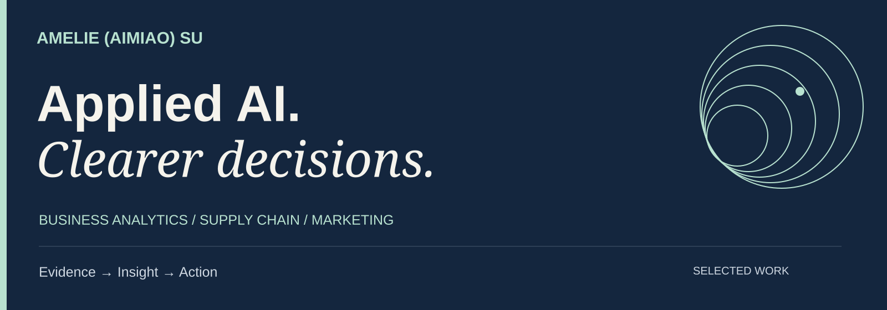
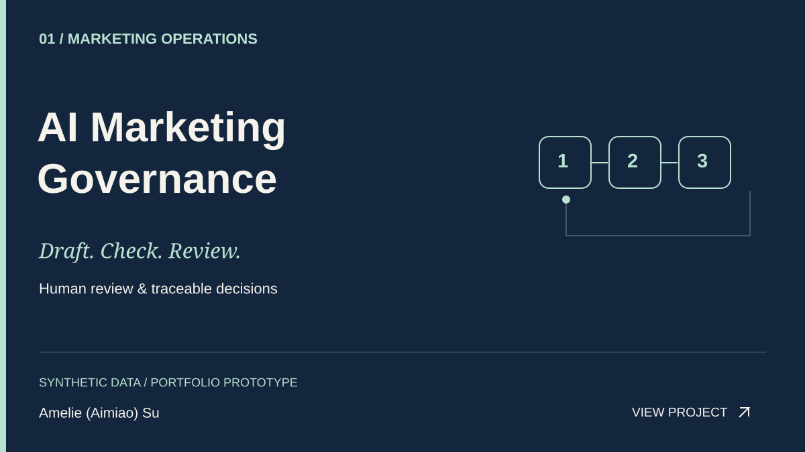
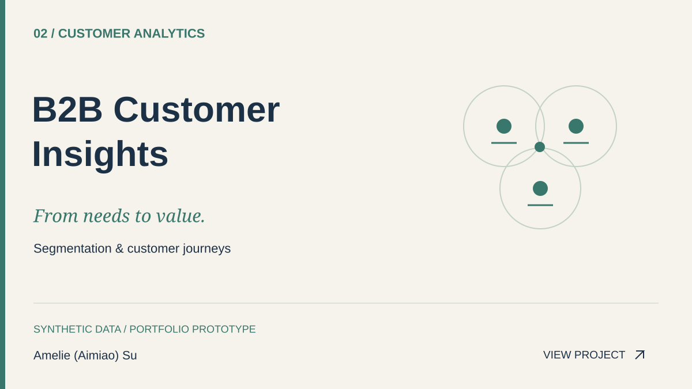
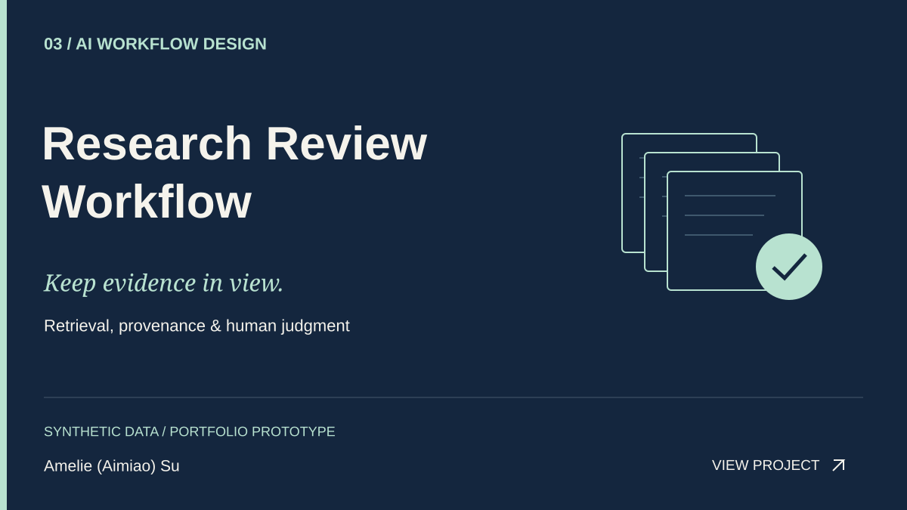
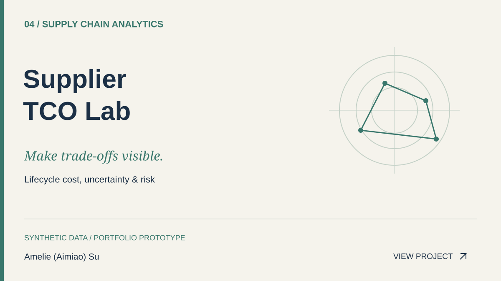

  

  <a href="https://www.linkedin.com/in/aimiaosu/">LinkedIn</a> ·
  <a href="https://github.com/aimiaosu-blip?tab=repositories">Explore my repositories</a>

## Hi, I'm Amelie (Aimiao) Su

I connect business questions with data, practical AI applications and clear decision support. My experience spans supply-chain analytics, commercial analysis and university research.

Here, I explore **AI workflows, marketing insights and supply-chain decisions** through transparent, reviewable prototypes.

## Selected work

These are independent portfolio projects using **synthetic data**. Results illustrate assumptions and methods rather than measured business impact. Repository links include the source and local setup instructions.

<table>
<tr>
<td width="50%" valign="top">

<h3>AI Marketing Governance</h3>

Explore editable drafts, wording checks, human approval and an auditable review workflow.

Python · Streamlit · SQLite

<a href="https://github.com/aimiaosu-blip/ai-marketing-transformation-">View project →</a>

</td>
<td width="50%" valign="top">

<h3>B2B Customer Insights</h3>

Explore customer needs, journey friction and value propositions through a transparent research dashboard.

Python · pandas · Streamlit

<a href="https://github.com/aimiaosu-blip/b2b-customer-insights">View project →</a>

</td>
</tr>
<tr>
<td width="50%" valign="top">

<h3>Research Review Workflow</h3>

Explore guided clarification, evidence retrieval and human decisions, with optional language-model adapters.

Python · SQLite · HTML / CSS / JS

<a href="https://github.com/aimiaosu-blip/LLM-Assisted-Research-Review-Workflow-Prototype">View project →</a>

</td>
<td width="50%" valign="top">

<h3>Supplier TCO Lab</h3>

Compare lifecycle cost, uncertainty and sourcing priorities using Monte Carlo simulation and sensitivity analysis.

Python · NumPy · Plotly · Streamlit

<a href="https://github.com/aimiaosu-blip/china-europe-supplier-tco">View project →</a>

</td>
</tr>
</table>

## How I approach a problem

**Frame the question → Inspect the evidence → Build a reviewable workflow → Communicate the trade-offs**

- Make assumptions and data limitations visible.
- Keep human judgment in decisions that need it.
- Connect analysis to a clear business question.

## Tools across my experience and projects

**Analysis:** Python · SQL · Power BI · Excel  
**Prototyping & visualization:** Streamlit · pandas · Plotly  
**Workflow & collaboration:** Power Automate · GitHub

## Let's connect

I'm interested in conversations about **AI applications, business analytics and digital transformation** across supply chains and marketing.

[Find me on LinkedIn](https://www.linkedin.com/in/aimiaosu/)
